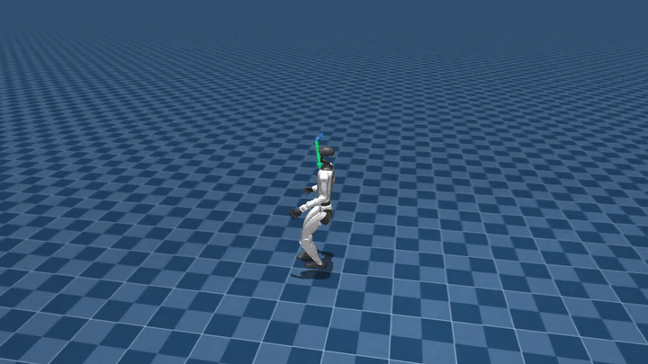

# unitree-g1-humanoid-walk

> **Base locomotion for the Unitree G1 humanoid.** Velocity-tracking flat-terrain walk trained end-to-end with PPO in mjlab (MuJoCo Warp) and exported to ONNX. Foundation stage of a loco-manipulation pipeline. Its terminal-state buffer warm-starts every downstream task.

[](LICENSE)
[](https://www.python.org/downloads/release/python-3100/)
[](https://github.com/google-deepmind/mujoco)
[](https://github.com/mujocolab/mjlab)
[](https://github.com/leggedrobotics/rsl_rl)
[](https://onnx.ai/)

<p align="center">
  
</p>
<p align="center"><sub>Four parallel rollouts of the trained walk policy tracking sampled velocity commands on flat terrain.</sub></p>

## Overview

The humanoid follows body-frame linear (vx, vy) and yaw-rate (wz) targets on flat ground. Proximal Policy Optimisation (PPO) trains a 29-DOF actor from scratch; the fused obs-normaliser + actor is exported to ONNX with embedded joint order and policy-rate metadata for direct deployment. Besides training the walk policy, this repo produces the yaw-aligned terminal-state buffer `outputs/walk_terminal_states.npz` that bootstraps every downstream task in the chain.

Key properties:
- **29-DOF whole-body control** at 50 Hz.
- **Yaw-aligned terminal buffer** so downstream resets inherit realistic walking postures, not a static keyframe.
- **Sagittal-plane mirror augmentation** doubles PPO batch size without extra rollouts.
- **Self-describing ONNX export** embeds joint order, policy frequency, and obs/action dims as metadata.

Scope boundaries: flat terrain only; no uneven ground, stairs, or external disturbance rejection (handled downstream by domain randomisation in the carry repo).

## Prerequisites

- **Python 3.10 exactly** (the notebook asserts this).
- **CUDA GPU.** Smoke run (64 envs) fits in ~4 GB VRAM; full training (8192 envs) is tuned for a NVIDIA B300 SXM6. Scale down via `src/tiers.py` for smaller GPUs.
- **[uv](https://github.com/astral-sh/uv)** for pinned installs (resolves against `requirements.txt`).
- **Headless MuJoCo:** `MUJOCO_GL=egl` (the notebook sets this automatically).

## Quickstart (~5 min on a laptop GPU)

```bash
git clone https://github.com/narayanerm/unitree-g1-humanoid-walk.git
cd unitree-g1-humanoid-walk
uv pip install -r requirements.txt
jupyter lab walk.ipynb
```

Set `DEBUG_LIGHT = True` in the first cell (64 envs x 3 PPO iterations) and Run All. Expect: a 29-joint actor dumped under `outputs/logs/g1_walk/<timestamp>/`, no terminal-state buffer yet (produced by the full run), and TensorBoard scalars climbing on `Episode/rew_track_lin_vel_xy`.

## Full training

Leave `DEBUG_LIGHT = False` and set the tier in `src/tiers.py` (default `T3K_XL`: 8192 envs x 1000 iters, ~2 to 4 h on B300). Notebook flags:

| Flag                   | Effect                                                              |
| ---------------------- | ------------------------------------------------------------------- |
| `REUSE_TRAINING`       | Skip training if a `model_*.pt` already exists under the log dir.   |
| `RESUME`               | Continue PPO from the newest checkpoint instead of fresh init.      |
| `DEBUG_LIGHT`          | Smoke-test tier (64 envs x 3 iters).                                |

The notebook sequence:
1. Register `Mjlab-Velocity-Flat-Unitree-G1-Custom` with mjlab.
2. Train PPO (`rsl_rl`) with sagittal-plane mirror augmentation.
3. Export the fused actor to ONNX.
4. Collect 20 k terminal states into `outputs/walk_terminal_states.npz`.

Regenerate the terminal buffer by itself (needed if the walk checkpoint changes):

```bash
python -m src.collect_buffer \
  --policy-module src.policy_walk \
  --checkpoint outputs/logs/g1_walk/<timestamp>/model_<N>.pt \
  --out outputs/walk_terminal_states.npz \
  --num-envs 2048 --n-snapshots 20000
```

Snapshots are stored yaw-aligned in the robot body frame (`SNAPSHOT_YAW_ALIGN=True`); downstream tasks rely on that convention.

## Using the trained policy

**Live viewer (viser at `http://localhost:8080`):**

```bash
python view.py
```

**Export to ONNX for deployment:**

```python
from src.utils import export_policy_to_onnx
export_policy_to_onnx(
    checkpoint="outputs/logs/g1_walk/<timestamp>/model_<N>.pt",
    task_id="Mjlab-Velocity-Flat-Unitree-G1-Custom",
    out_path="outputs/g1_walk.onnx",
)
```

The exported file embeds `joint_order` (29 strings), `policy_hz`, `obs_dim`, `act_dim` as ONNX metadata. The firmware side needs no extra config.

**Inspect training curves:**

```bash
tensorboard --logdir outputs/logs/g1_walk
```

## Repo layout

```
src/
  policy_walk.py       MDP, PPO cfg, scene, curriculum. TASK_ID = "Mjlab-Velocity-Flat-Unitree-G1-Custom".
  train_loop.py        PPO runner with warm-start / resume plumbing.
  collect_buffer.py    Generic terminal-state collector (shared with every sibling repo).
  utils.py             find_latest_checkpoint, TB parsing, ONNX export.
  symmetry.py          Sagittal-plane mirror (mirror_walk_obs, mirror_walk_action).
  tiers.py             Named env x iter presets.
walk.ipynb             Primary entry point.
view.py                Standalone viser launcher.
outputs/
  logs/g1_walk/        Checkpoints + TB events (kept).
  walk_terminal_states.npz  Reset buffer for downstream tasks (kept).
```

## Technology stack

| Component           | Choice                                                        |
| ------------------- | ------------------------------------------------------------- |
| Physics simulator   | MuJoCo Warp (GPU-parallel) via **mjlab**                      |
| RL algorithm        | PPO (`rsl_rl`), adaptive LR, GAE(λ=0.95), clip=0.2            |
| Policy architecture | 3-layer MLP (512-256-128, ELU), observation normalisation     |
| Observation         | 99 D (base vel, projected gravity, 29 D q+dq, last a, cmd)    |
| Action              | 29 D joint position targets (per-joint scale, default offset) |
| Data augmentation   | Sagittal-plane mirror ([src/symmetry.py](src/symmetry.py))    |
| Reward curriculum   | Progressive command-range unlock (`src.policy_walk`)          |
| Deployment          | ONNX export (fused normaliser, embedded policy Hz + joints)   |
| Compute target      | 1x NVIDIA B300 SXM6 (tuned); scalable via `src/tiers.py`      |

## Design decisions

- **Flat `src/` layout.** Every module imports as `src.<name>`. One policy file, one training loop, one buffer collector. No hidden framework.
- **Yaw-aligned snapshots.** `collect_buffer` writes states in the robot body-yaw frame (`SNAPSHOT_YAW_ALIGN=True`). Downstream tasks reset into realistic walking postures without inheriting world-frame orientation bias.
- **Mirror augmentation respects history.** The mirror operates on `(..., k x 99)` tensors so stacked observations are mirrored per time slice. See [`src.symmetry.mirror_walk_obs`](src/symmetry.py).
- **ONNX export is deployment-first.** `src.utils.export_policy_to_onnx` fuses the obs normaliser into the actor and embeds joint order, policy frequency, obs/action dims as metadata. The file is self-describing for downstream firmware.

## Troubleshooting

| Symptom                                                        | Likely cause / fix                                                                                            |
| -------------------------------------------------------------- | ------------------------------------------------------------------------------------------------------------- |
| `AssertionError: Python 3.10 required`                         | Create a 3.10 venv (`uv venv --python 3.10`) and re-install.                                                   |
| `OSError: EGL not available`                                   | Install `mesa-utils` + `libegl1`; confirm `MUJOCO_GL=egl` is in env.                                           |
| OOM on PPO rollout                                             | Drop `NUM_ENVS` in `src/tiers.py` (`T1_SANITY` for 64 envs, `T1K_M` for 1024).                                 |
| `walk_terminal_states.npz missing`                             | Re-run `python -m src.collect_buffer ...` with the newest `model_*.pt`.                                        |
| ONNX export: `shape mismatch at mlp.6`                         | Checkpoint uses a diagnostic trunk-frozen head; `export_policy_to_onnx` auto-detects this but confirm the key `mlp.6.0.weight` is present. |

## Pipeline position

Foundation of the chain. Its checkpoint and terminal-state buffer feed every downstream task:

```
WALK (here)  -->  walk_terminal_states.npz
                      |
                      v
                     PICK  -->  pick_terminal_states.npz
                      |
                      v
                 CARRY / PLACE
```

Also warm-starts `reach` (standing bimanual reaching) as an auxiliary branch.

| Repo | Role |
| --- | --- |
| **[walk](.)** ← you are here | Base locomotion + terminal-state buffer |
| [reach](../unitree-g1-humanoid-reach) | Standing bimanual reach (+ RMA student) |
| [pick](../unitree-g1-humanoid-pick) | Walk to table + bimanual grasp |
| [carry](../unitree-g1-humanoid-carry) | Walk while carrying (rigid / slosh / soft) |
| [place](../unitree-g1-humanoid-place) | Set the carried box down |
| [fsm](../unitree-g1-humanoid-fsm) | Chain experts into a unified BC dataset |
| [monolithic-policy](../unitree-g1-humanoid-monolithic-policy) | Single MLP end-to-end alternative |

## Citation

```bibtex
@misc{medeiros2026g1walk,
  author       = {Ribeiro Medeiros, Narayane},
  title        = {unitree-g1-humanoid-walk: base locomotion policy for the Unitree G1 in mjlab},
  year         = {2026},
  howpublished = {\url{https://github.com/narayanerm/unitree-g1-humanoid-walk}}
}
```

## Author & License

**Narayane Ribeiro Medeiros**, Instituto Tecnológico de Aeronáutica.
[GitHub](https://github.com/narayanerm) | [LinkedIn](https://www.linkedin.com/in/narayanerm) | narayane.rm@gmail.com

Released under the [MIT License](LICENSE).
